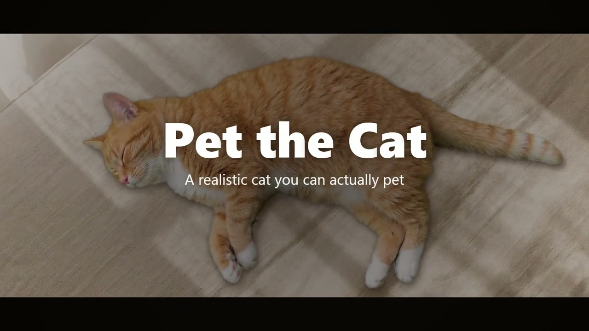
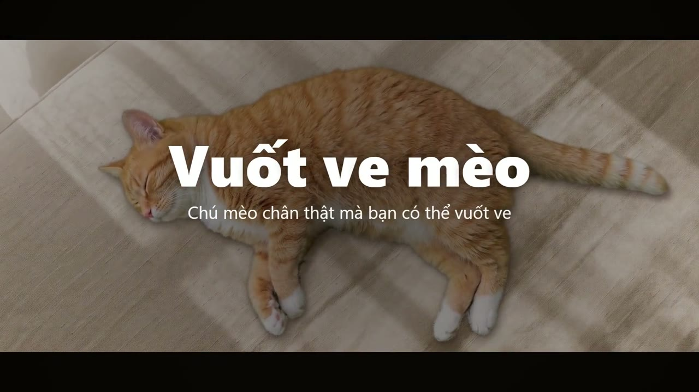

# Pet the Cat · Vuốt ve mèo

A realistic cat you can pet in the browser, seen from above on a sunny cushion.

**Play:** https://lyducanh.github.io/pet-cat/

## Video

| English | Tiếng Việt |
|---|---|
| [](https://lyducanh.github.io/pet-cat/media/promo-en.mp4) | [](https://lyducanh.github.io/pet-cat/media/promo-vi.mp4) |

Click a picture to play the video (64 s, 1080p). Bấm vào ảnh để xem video.

- **Stroke its back:** it relaxes, purrs, and its fur follows your hand.
- **Scratch above the tail:** it stands up and raises its hips.
- **Grab the tail:** it follows your hand, then swishes back.
- **Keep petting:** it rolls onto its back.
- 7 breeds, 13 coat colours, size and body shape, night mode, English and Tiếng Việt.

## How it works

Photo cut-outs (generated with Gemini on a green screen) are drawn with WebGL on deformable meshes:
springs for the weight of the hand, fur sheen that follows your strokes, a tail made of a bending
strip, soft contact shadows, and a camera that slowly drifts and closes in as the cat relaxes.

## Run locally

```bash
python tools/devserver.py 8766
```

Then open http://localhost:8766/index.html.

- `tools/prep.html`: cuts out the green-screen photos and writes `assets/top/out/` (needs the source photos, not in this repo).
- `tools/promo.js`: renders the promo video from the app itself.
